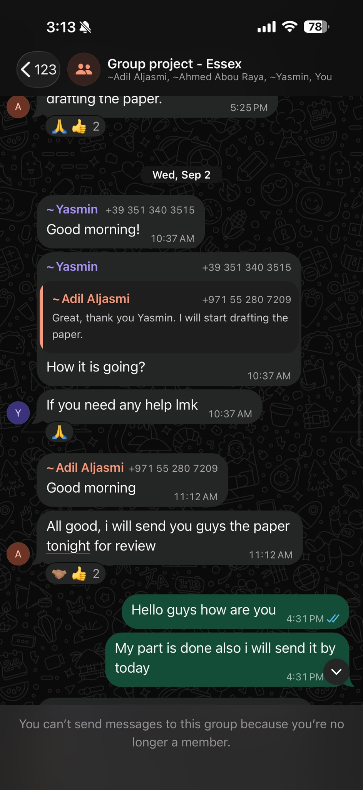

# Individual Module e-Portfolio

## Intelligent Agents – IA_PCOM7E

**Student Name:** Essa Alboinin 

**Module:** Intelligent Agents (IA_PCOM7E)  
**Assessment:** Individual Module e-Portfolio  
**E-Portfolio URL:**  
**GitHub Repository:** https://github.com/essaalbuainain/ScholarPlan

---

# 1. Introduction

This e-portfolio is a record of my progressive learning and development through the Intelligent Agents module. It combines project artifacts, collaborative activities and critical reflection in line with the role of e-portfolios as integrated records of educational development (Lorenzo and Ittelson, 2005). The evidence is directly linked to the module learning outcomes through architecture analysis, practical agent development, responsible deployment, collaborative work and critical reflection.

| Learning Outcome | Evidence |
|---|---|
| LO1 Agent architectures | Sections 2.1–2.3; Figure 6 |
| LO2 Apply/evaluate agent techniques | KQML, NLP and ScholarPlan testing |
| LO3 Tools, ethics and implementation | LM Studio, APIs, Critic and case studies |
| LO4 Virtual teamwork | Section 2.2; Figures 2, 4 and 5 |

# 2. Learning and Development Evidence

## 2.1 Agent-Based Systems – Units 1–3

The first collaborative discussion helped me develop my understanding of the utility of agent-based computing in dynamic and distributed environments. Intelligent agents can be autonomous, reactive, pro-active and social; this means that they can react to changes in the environment and not only follow pre-determined workflows (Wooldridge, 2009). 

Peer discussion led me to question whether more autonomy is always desirable. Sergei’s real-world example demonstrated the value of resilience when an external service is unavailable, and Tugba’s talk stressed accountability and oversight by humans. I therefore developed a greater understanding of bounded autonomy, where agents are allowed to undertake appropriate tasks independently but are subject to limits and escalation mechanisms (Parasuraman, Sheridan and Wickens, 2000). 

This had a direct influence on ScholarPlan. Instead of relying on one LLM to undertake the entire research process, the task was distributed across specialized components.


*Figure 1. My initial contribution to the Agent-Based Systems discussion.*


*Figure 2. Evidence of engagement with peers on autonomy, resilience and oversight.*


*Figure 3. Summary reflection for Units 1–3.*

## 2.2 Teamwork and Individual Contribution

During the team design stage, we faced the task of coordinating responsibilities and debating alternative architectural decisions before development. I participated in discussions on how the proposed research agent should divide responsibilities between planning, information retrieval, processing and verification. 

This demonstrated the benefits of multiple viewpoints working collaboratively in software architecture. Simple decisions had to be explained and justified to the rest of the team.

This made me more aware to write down assumptions more clearly and if individual design choices could be tested later. The experience also improved my capacity to contribute to a virtual development team and respond constructively to feedback.



*Figure 4. Evidence of my contribution to team planning and project coordination.*


*Figure 5. Evidence of team feedback and collaborative decision-making.*

## 2.3 Hybrid Agent Architectures – Unit 4

The fourth unit showed that the agent architecture should be selected according to the needs of the application. The ScholarPlan thus became a modular system of a Planner, Retriever, Processor, Critic and Archivist, all managed through a shared SQLite blackboard. 

The Planner decomposes the research goal, the Retriever fetches scholarly information, the Processor generates candidate claims, the Critic independently evaluates these claims and the Archivist produces the final outputs. These responsibilities were separated, making it easier to inspect, test, and change each stage . 

The blackboard also gave persistent state and the interactions between components were visible, not an opaque sequence of operations.


*Figure 6. ScholarPlan modular multi-agent architecture.*

## 2.4 Agent Communication – Units 5–7

The second collaborative discussion was a comparison of KQML and traditional Python or Java method calls. KQML describes communication via performatives such as ask, tell, request and reply, which explicitly describe the purpose of a message (Finin et al., 1994). This can support loosely coupled agents, but communication still relies on agreed semantics and ontologies (Labrou, Finin and Peng, 1999). 

This idea was put into practice in the Alice and Bob KQML/KIF exercise. Alice, who works in procurement, asked Bob for warehouse information, in structured messages. This later influenced ScholarPlan where I used KQML inspired request, inform, confirm and reject messages. These interactions were also tracked on the blackboard to enable traceability.


*Figure 7. Discussion comparing KQML and conventional method invocation.*

```text
Alice → Bob

(ask-one
  :sender Alice
  :receiver Bob
  :language KIF
  :ontology warehouse-stock
  :content
    (available-stock television-50-inch ?quantity)
)

Bob → Alice

(tell
  :sender Bob
  :receiver Alice
  :language KIF
  :ontology warehouse-stock
  :content
    (available-stock television-50-inch 24))

Alice → Bob

(ask-one
  :sender Alice
  :receiver Bob
  :language KIF
  :ontology warehouse-stock
  :content
    (hdmi-slots television-50-inch ?slots)

Bob → Alice

(tell
  :sender Bob
  :receiver Alice
  :language KIF
  :ontology warehouse-stock
  :content
    (hdmi-slots television-50-inch 3)
```

**Activity Evidence. Structured KQML/KIF communication between Alice and Bob.**

## 2.5 NLP and Parse Trees – Unit 8

It was the development of constituency-based parse trees that allowed me to develop my understanding of hierarchical representations of language. The sentence “The man saw the dog with the telescope” was of particular help. This is because “with the telescope” can attach to either the verb phrase or the noun phrase, giving two interpretations. This demonstrated that surface structure alone is not always sufficient to extract meaning in natural-language systems, and that contextual reasoning may be necessary to disambiguate.


*Figure 8. Constituency-based parse tree activity.*


*Figure 9. Syntactic ambiguity demonstrated through alternative parse trees.*

## 2.6 Deep Learning and Responsible AI – Units 9–11

Subsequent activities expanded my focus beyond just technical capability to more general implications of intelligent technologies. The Deep Learning discussion touched on hallucination, bias, privacy and accountability. Hallucination has been recognized as a major challenge for natural-language generation (Ji et al., 2023); more broadly, risks from bias in large language models have been noted (Bender et al., 2021). 

The Deep Learning in Action activity also showed that high predictive performance does not necessarily imply responsible deployment. The models used in medical image diagnosis applications also need representative data, transparency, adequate validation, and supervision by humans. 

This influenced my assessment of ScholarPlan as I cannot assume that an LLM output that looks academic is reliable just because it is fluent.


*Figure 10. My discussion of ethical issues associated with generative AI.*


*Figure 11. Application of deep learning and consideration of socio-technical risks.*

# 3. Critical Evaluation of ScholarPlan

In implementing Week 11 I was able to make a critical comparison of the working system against the earlier design. The main features were kept such as modular agents, the shared blackboard and the independent Critic. However, the tutor feedback highlighted three areas for improvement: no static UML Class Diagram, the evaluation criteria were too broad and no clear rule for repeated replanning failure. 

To solve these problems I added the UML diagram, measurable evaluation targets and I forced the replanning to be done only thrice before the task is considered unresolvable.


*Figure 12. Tutor feedback that informed the final ScholarPlan implementation.*

Also, the implementation was technically changed. Azure was considered at design time, but the final working demo used Qwen2.5-3B-Instruct via LM Studio. Live scholarly retrieval was done via OpenAlex, Crossref and arXiv.

Testing revealed problems that hadn't been apparent during design. They include badly-formed structured responses and unreliable model outputs. So, JSON repair and source-grounded fallback behavior were added. We also added a relevance gate that prevented evidence-supported but off-topic claims from automatically making it into the final report. The completed live run processed 3 tasks, retrieved 15 records and produced 12 verified claims with evidence. The automated test suite passed all 7 tests, including the three-attempt replanning rule.


*Figure 13. Successful ScholarPlan live execution.*


*Figure 14. Unit and functional testing evidence.*


*Figure 15. Auditable inter-agent communication and verification.*

# 4. Three Reflective Case Studies

## 4.1 AI Safety Constraints

**WHAT:** If a subtask failed to produce acceptable evidence, then ScholarPlan might replan over and over. I’ve set it so you only have three tries until the task becomes impossible. 

**SO WHAT:** This established autonomy needs explicit safety boundaries. An unrestricted loop could waste resources and cause unpredictable behavior. 

**NOW WHAT:** For future projects, I would define retry limits, escalation mechanisms and human intervention points from the start instead of adding them after implementation.

## 4.2 Explainable Decisions

**WHAT:** ScholarPlan logs messages, retrieved evidence and Critic decisions in the SQLite blackboard and execution trace. 

**SO WHAT:** This helps me understand why claims were accepted, rejected or replanned. I learned that explainability can be about making the decision process of an agent observable, rather than only trying to explain the neural model itself. 

**NOW WHAT:** Future versions will provide clearer rejection reasons, links to evidence, and confidence indicators for users.

## 4.3 Responsible Deployment

**WHAT:** Live LLM output can be either malformed, unsupported or insufficiently relevant to the original question. 

**SO WHAT:** I learned that successful text generation is not the same as reliable deployment. When the outputs can influence academic research, verification, relevance assessment and failure handling are important. 

**NOW WHAT:** I would improve the semantic retrieval, evaluate the system on larger labeled datasets and introduce human review for high-risk outputs.

# 5. Final Reflective Commentary

This reflection is based on the framework of Rolfe, Freshwater and Jasper (2001) of WHAT, SO WHAT and NOW WHAT.

## WHAT

At the beginning of the Intelligent Agents module I saw agents primarily as independent pieces of software capable of performing tasks on behalf of users. Early work focused on autonomy, coordination, and different agent architectures, and later work addressed KQML, NLP, deep learning, and responsible AI. ScholarPlan integrated these areas into one practical application. 

My last system was a Planner, Retriever, Processor, Critic and Archivist organized via a persistent SQLite blackboard. That was different from my earlier assumption that an intelligent research agent could be built largely by hooking up an LLM to external information sources. 

The implementation phase proved to be more difficult than the design phase. I was thinking about Azure at first but I ended up using Qwen2.5-3B-Instruct through LM Studio. Once the model was attached to the data, I saw malformed JSON, incomplete planning outputs and candidate claims that had to be rejected. These problems called for JSON repair, fallback behavior, bounded replanning and a relevance gate.


## SO WHAT

Those failures were some of my best learning experiences. At first we were frustrated with constant integration problems. Another component may be working correctly, but fails when it interacts with retrieval, processing and verification. Sometimes I jumped too fast to changing the prompt without finding the source of the problem first. 

Eventually I came up with a more systematic debugging process. Then I broke the workflow down into planning, retrieval, processing, verification and publication and looked at each step in isolation. It reduced uncertainty and made isolating failures easier. What I learned from this experience is that building intelligent systems is about planning for failure, not just showing successful outputs. 

Here the tutor feedback on the previous design was of particular use. For instance, the design requirement to “support replanning” was too vague to be evaluated objectively. We decided to limit the attempts to three so that it could be a measurable, testable behavior. Similar vague criteria were laid down for evaluation. Now I can see the value of defining measurable requirements earlier in the development cycle. 

My own view of communication has also shifted. The KQML activities showed how agent messages could be used to express content and intention. ScholarPlan did not implement the full KQML specification, but the use of request, inform, confirm and reject made it easier to inspect interactions. Writing them on the blackboard created an audit trail, and showed me that explainability can be achieved to some degree through system architecture. 

The talks around deep learning also helped me to adjust how I evaluate model quality. I would have thought a smooth answer was evidence that an LLM was doing its job right. It's clear to me now how fluency can cover up a lack of support. Hence, apart from technical performance, one must also consider hallucination, bias, relevance and accountability. This was especially critical for ScholarPlan as false academic-style writing could appear credible to a user. 

So the Critic was turning into one of the most valuable parts of the structure. The division of generation and verification meant that the generated claims were not necessarily the final output. This was making the idea of using LLMs in systems that provide independent verification, rather than treating them as authoritative sources, more attractive. 

Teamwork also impacted my learning. I had to make architectural decisions, which meant I had to explain and justify assumptions and I learned about alternative approaches through conversations with peers. That made me realize feedback is part of development, not just an assessment of work when it’s done.


## NOW WHAT

If I would develop ScholarPlan again, I would change the sequence of development. I would begin by defining measurable evaluation criteria, creating deterministic tests and defining structured-output schemas early on, prior to integrating the LLM. I would also from the start architect failure states and retry limits and escalation mechanisms. 

The relevance component could also be improved. The present implementation employs a transparent lexical baseline, while future work may employ Sentence-BERT embeddings for semantic similarity (Reimers and Gurevych, 2019). I would assess this with a bigger labeled dataset instead of just using demonstration queries. 

For higher-stakes applications, I would add explicit human approval points and more explicit reporting of uncertainty. The most important thing I learned from the module is that you shouldn’t evaluate an intelligent system only by the appearance of the capabilities of the underlying model. It should also be evaluated on how its decisions are verified, explained, bounded, tested and monitored. This new way of looking at things will affect my future work on intelligent-agent development.


# 6. Professional Skills Matrix and PDP

| Skill | Current Evidence | Next Action |
|---|---|---|
| Critical thinking | Critic and relevance evaluation | Use larger evaluation sets |
| IT & Digital | Python, SQLite, LM Studio, GitHub | Develop CI/CD skills |
| Problem-solving | JSON repair and fallback logic | Test failure cases earlier |
| Teamwork | Team design and peer discussions | Maintain structured meeting notes |
| Ethical awareness | Safety, XAI and deployment case studies | Define human-oversight criteria |

My PDP therefore stresses better evaluation, automated testing, structured collaboration and responsible agent deployment.

# References

Bender, E.M., Gebru, T., McMillan-Major, A. and Shmitchell, S. (2021) ‘On the dangers of stochastic parrots: Can language models be too big?’, Proceedings of the 2021 ACM Conference on Fairness, Accountability, and Transparency, pp. 610–623.

Finin, T., Fritzson, R., McKay, D. and McEntire, R. (1994) ‘KQML as an agent communication language’, Proceedings of the Third International Conference on Information and Knowledge Management, pp. 456–463.

Ji, Z. et al. (2023) ‘Survey of hallucination in natural language generation’, ACM Computing Surveys, 55(12), Article 248.

Labrou, Y., Finin, T. and Peng, Y. (1999) ‘Agent communication languages: The current landscape’, IEEE Intelligent Systems and Their Applications, 14(2), pp. 45–52.

Lorenzo, G. and Ittelson, J. (2005) An Overview of E-Portfolios. EDUCAUSE Learning Initiative.

Parasuraman, R., Sheridan, T.B. and Wickens, C.D. (2000) ‘A model for types and levels of human interaction with automation’, IEEE Transactions on Systems, Man, and Cybernetics – Part A: Systems and Humans, 30(3), pp. 286–297.

Reimers, N. and Gurevych, I. (2019) ‘Sentence-BERT: Sentence embeddings using Siamese BERT-networks’, Proceedings of EMNLP-IJCNLP 2019, pp. 3982–3992.

Rolfe, G., Freshwater, D. and Jasper, M. (2001) Critical Reflection in Nursing and the Helping Professions: A User’s Guide. Basingstoke: Palgrave Macmillan.

Wooldridge, M. (2009) An Introduction to MultiAgent Systems. 2nd edn. Chichester: Wiley.
