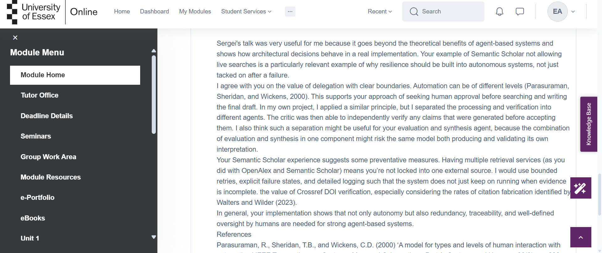
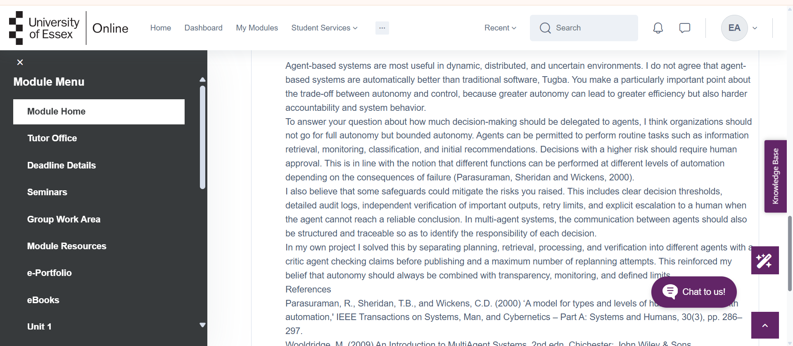

# Individual Module e-Portfolio

## Intelligent Agents – IA_PCOM7E

**Student Name:** Essa Alboinin 

**Module:** Intelligent Agents (IA_PCOM7E)  
**Assessment:** Individual Module e-Portfolio  
**E-Portfolio URL:**  
**GitHub Repository:** https://github.com/essaalbuainain/ScholarPlan

---

# 1. Introduction

This e-portfolio documents my progressive learning and development across the Intelligent Agents module, combining project artefacts, collaborative activities and critical reflection in line with the role of e-portfolios as integrated records of educational development (Lorenzo and Ittelson, 2005). The evidence maps directly to the module learning outcomes through architecture analysis, practical agent development, responsible deployment, collaborative work and critical reflection.

| Learning Outcome | Evidence |
|---|---|
| LO1 Agent architectures | Sections 2.1–2.3; Figure 6 |
| LO2 Apply/evaluate agent techniques | KQML, NLP and ScholarPlan testing |
| LO3 Tools, ethics and implementation | LM Studio, APIs, Critic and case studies |
| LO4 Virtual teamwork | Section 2.2; Figures 2, 4 and 5 |

# 2. Learning and Development Evidence

## 2.1 Agent-Based Systems – Units 1–3

The first collaborative discussion developed my understanding of why agent-based computing is useful in dynamic and distributed environments. Intelligent agents can demonstrate autonomy, reactivity, pro-activeness and social ability, allowing them to respond to environmental changes rather than following only fixed workflows (Wooldridge, 2009).

Peer discussion made me question whether greater autonomy is always desirable. Sergei’s practical example demonstrated the importance of resilience when an external service becomes unavailable, while Tugba’s discussion emphasised accountability and human oversight. I therefore developed a stronger understanding of bounded autonomy, where agents are allowed to undertake appropriate tasks independently but remain subject to limits and escalation mechanisms (Parasuraman, Sheridan and Wickens, 2000).

This directly influenced ScholarPlan. Instead of relying on a single LLM to perform the complete research process, responsibilities were divided across specialist components.


*Figure 1. My initial contribution to the Agent-Based Systems discussion.*





*Figure 2. Evidence of engagement with peers on autonomy, resilience and oversight.*


*Figure 3. Summary reflection for Units 1–3.*

## 2.2 Teamwork and Individual Contribution

The team design stage required us to coordinate responsibilities and discuss alternative architectural decisions before development. My contribution involved participating in discussions about how the proposed research agent should divide responsibilities between planning, information retrieval, processing and verification.

Working collaboratively demonstrated that software architecture benefits from multiple viewpoints. Decisions that initially appeared straightforward had to be explained and justified to other team members. This encouraged me to document assumptions more clearly and consider whether individual design choices could be tested later. The experience also strengthened my ability to contribute to a virtual development team and respond constructively to feedback.


*Figure 4. Evidence of my contribution to team planning and project coordination.*


*Figure 5. Evidence of team feedback and collaborative decision-making.*

## 2.3 Hybrid Agent Architectures – Unit 4

Unit 4 demonstrated that agent architecture should be selected according to application requirements. ScholarPlan consequently developed into a modular system consisting of a Planner, Retriever, Processor, Critic and Archivist, coordinated through a shared SQLite blackboard.

The Planner decomposes the research goal, the Retriever obtains scholarly information, the Processor generates candidate claims, the Critic independently evaluates those claims and the Archivist produces the final outputs. Separating these responsibilities made individual stages easier to inspect, test and modify.

The blackboard also provided persistent state and made interactions between components observable rather than creating an opaque sequence of operations.


*Figure 6. ScholarPlan modular multi-agent architecture.*

## 2.4 Agent Communication – Units 5–7

The second collaborative discussion compared KQML with conventional Python or Java method invocation. KQML represents communication through performatives such as ask, tell, request and reply, explicitly describing the purpose of a message (Finin et al., 1994). This can support loosely coupled agents, although communication still depends on agreed semantics and ontologies (Labrou, Finin and Peng, 1999).

The Alice and Bob KQML/KIF exercise translated this concept into practice. Alice, acting as a procurement agent, requested warehouse information from Bob through structured messages. This later influenced ScholarPlan, where I used KQML-inspired request, inform, confirm and reject messages. These interactions were recorded through the blackboard, increasing traceability.


*Figure 7. Discussion comparing KQML and conventional method invocation.*

```text
Alice → Bob

(ask-one
  :sender Alice
  :receiver Bob
  :language KIF
  :ontology warehouse-stock
  :content
    (available-stock television-50-inch ?quantity)
)

Bob → Alice

(tell
  :sender Bob
  :receiver Alice
  :language KIF
  :ontology warehouse-stock
  :content
    (available-stock television-50-inch 24))

Alice → Bob

(ask-one
  :sender Alice
  :receiver Bob
  :language KIF
  :ontology warehouse-stock
  :content
    (hdmi-slots television-50-inch ?slots)

Bob → Alice

(tell
  :sender Bob
  :receiver Alice
  :language KIF
  :ontology warehouse-stock
  :content
    (hdmi-slots television-50-inch 3)
```

**Activity Evidence. Structured KQML/KIF communication between Alice and Bob.**

## 2.5 NLP and Parse Trees – Unit 8

Creating constituency-based parse trees developed my understanding of hierarchical language representations. The sentence “The man saw the dog with the telescope” was particularly useful because “with the telescope” can attach either to the verb phrase or the noun phrase, resulting in two interpretations.

This demonstrated that natural-language systems cannot always determine meaning from surface structure alone and may require contextual reasoning to resolve ambiguity.


*Figure 8. Constituency-based parse tree activity.*


*Figure 9. Syntactic ambiguity demonstrated through alternative parse trees.*

## 2.6 Deep Learning and Responsible AI – Units 9–11

The later activities expanded my focus from technical capability to the wider implications of intelligent technologies. The Deep Learning discussion considered hallucination, bias, privacy and accountability. Ji et al. (2023) identify hallucination as an important challenge in natural-language generation, while Bender et al. (2021) highlight broader risks associated with bias in large language models.

The Deep Learning in Action activity further demonstrated that high predictive performance does not automatically mean responsible deployment. In applications such as medical image diagnosis, models also need representative data, transparency, appropriate validation and human oversight.

This affected how I evaluated ScholarPlan because academic-looking LLM output cannot be assumed to be reliable simply because it is fluent.


*Figure 10. My discussion of ethical issues associated with generative AI.*


*Figure 11. Application of deep learning and consideration of socio-technical risks.*

# 3. Critical Evaluation of ScholarPlan

The Week 11 implementation allowed me to critically compare the working system with the earlier design. Core features such as modular agents, the shared blackboard and independent Critic were retained. However, tutor feedback identified three areas for improvement: a missing static UML Class Diagram, overly broad evaluation criteria and the absence of a clear rule for repeated replanning failure.

I addressed these issues by adding the UML diagram, introducing measurable evaluation targets and limiting replanning to three attempts before a task is marked unresolvable.


*Figure 12. Tutor feedback that informed the final ScholarPlan implementation.*

The implementation also changed technically. Azure was considered during the design phase, but the final working demonstration used Qwen2.5-3B-Instruct through LM Studio. Live scholarly retrieval used OpenAlex, Crossref and arXiv.

Testing revealed problems that had not been obvious during design. These included malformed structured responses and unreliable model outputs. JSON repair and source-grounded fallback behaviour were therefore added. A relevance gate was also implemented so that evidence-supported but off-topic claims did not automatically enter the final report.

The completed live run processed three tasks, retrieved 15 records and produced 12 evidence-verified claims. The automated test suite reported 7/7 passing tests, including the three-attempt replanning rule.


*Figure 13. Successful ScholarPlan live execution.*


*Figure 14. Unit and functional testing evidence.*


*Figure 15. Auditable inter-agent communication and verification.*

# 4. Three Reflective Case Studies

## 4.1 AI Safety Constraints

**WHAT:** ScholarPlan could repeatedly replan when a subtask failed to generate acceptable evidence. I introduced a limit of three attempts before the task became unresolvable.

**SO WHAT:** This demonstrated that autonomy requires explicit safety boundaries. An unrestricted loop could waste resources and create unpredictable behaviour.

**NOW WHAT:** In future projects, I would define retry limits, escalation mechanisms and human intervention points from the beginning rather than adding them after implementation.

## 4.2 Explainable Decisions

**WHAT:** ScholarPlan records messages, retrieved evidence and Critic decisions in the SQLite blackboard and execution trace.

**SO WHAT:** This allows me to identify why claims were accepted, rejected or replanned. I learned that explainability can involve making an agent's decision process observable, rather than attempting only to explain the neural model itself.

**NOW WHAT:** Future versions would include clearer rejection reasons, evidence links and confidence indicators for users.

## 4.3 Responsible Deployment

**WHAT:** Live LLM output could be malformed, unsupported or insufficiently relevant to the original question.

**SO WHAT:** I learned that successful text generation is not equivalent to reliable deployment. Verification, relevance assessment and failure handling are essential when outputs may influence academic research.

**NOW WHAT:** I would strengthen semantic retrieval, evaluate the system on larger labelled datasets and introduce human review for high-risk outputs.

# 5. Final Reflective Commentary

This reflection follows the WHAT, SO WHAT and NOW WHAT framework of Rolfe, Freshwater and Jasper (2001).

## WHAT

At the beginning of the Intelligent Agents module, I understood agents mainly as autonomous software components capable of performing tasks on behalf of users. The early discussions introduced autonomy, coordination and different agent architectures, while later activities addressed KQML, NLP, deep learning and responsible AI. ScholarPlan brought these areas together in one practical implementation.

My final system included a Planner, Retriever, Processor, Critic and Archivist coordinated through a persistent SQLite blackboard. This was different from my earlier assumption that an intelligent research agent could largely be created by connecting an LLM to external information sources.

The implementation stage was more difficult than the design stage. Azure had originally been considered, but I eventually used Qwen2.5-3B-Instruct through LM Studio. After connecting the model, I encountered malformed JSON, incomplete planning outputs and candidate claims that had to be rejected. These problems required JSON repair, fallback behaviour, bounded replanning and a relevance gate.

## SO WHAT

These failures became some of my most important learning experiences. Initially, repeated integration problems were frustrating because an individual component could appear to work correctly but fail once it interacted with retrieval, processing and verification. I sometimes focused too quickly on changing the prompt rather than first identifying the exact source of the problem.

Gradually, I adopted a more systematic debugging process. I separated the workflow into planning, retrieval, processing, verification and publication, and examined each stage individually. This reduced uncertainty and made failures easier to isolate. The experience taught me that developing intelligent systems requires planning for failure, not only demonstrating successful outputs.

The tutor feedback on the earlier design became particularly useful at this stage. For example, the design requirement to “support replanning” was too broad to evaluate objectively. Implementing a maximum of three attempts transformed it into a measurable and testable behaviour. Similarly, broad evaluation criteria were converted into clearer targets. I now understand why measurable requirements should be established earlier in the development process.

My understanding of communication also changed. The KQML activities showed that agent messages can express both content and intention. ScholarPlan did not implement the entire KQML specification, but the use of request, inform, confirm and reject made interactions easier to inspect. Persisting them in the blackboard created an audit trail and showed me that explainability can be achieved partly through system architecture.

The deep-learning discussions also changed the way I evaluate model quality. Earlier, I might have considered a fluent response evidence that an LLM was functioning effectively. I now recognise that fluent language can hide unsupported claims. Hallucination, bias, relevance and accountability therefore need to be considered alongside technical performance. This was especially significant for ScholarPlan because inaccurate information presented in an academic style could appear credible to a user.

For this reason, the Critic became one of the most valuable parts of the architecture. Separating generation from verification meant that generated claims did not automatically become final outputs. This reinforced the principle that LLMs should operate within systems that provide independent checks rather than being treated as authoritative sources.

Teamwork also influenced my learning. Discussing architectural choices required me to explain and justify assumptions, while peer discussions exposed me to alternative approaches. This taught me to regard feedback as part of development rather than simply as evaluation after the work was completed.

## NOW WHAT

If I developed ScholarPlan again, I would change the sequence of development. I would define measurable evaluation criteria first, develop deterministic tests earlier and specify structured-output schemas before integrating the LLM. I would also design failure states, retry limits and escalation mechanisms from the beginning.

The relevance component could also be strengthened. The current implementation uses a transparent lexical baseline, while future development could use Sentence-BERT embeddings for semantic similarity (Reimers and Gurevych, 2019). I would evaluate this using a larger labelled dataset rather than relying mainly on demonstration queries.

For applications with greater consequences, I would introduce explicit human approval points and clearer uncertainty reporting. The most significant lesson I take from the module is that an intelligent system should not be judged only by how capable the underlying model appears. It should also be evaluated according to how its decisions are verified, explained, bounded, tested and monitored. This change in perspective will influence how I approach future intelligent-agent development.

# 6. Professional Skills Matrix and PDP

| Skill | Current Evidence | Next Action |
|---|---|---|
| Critical thinking | Critic and relevance evaluation | Use larger evaluation sets |
| IT & Digital | Python, SQLite, LM Studio, GitHub | Develop CI/CD skills |
| Problem-solving | JSON repair and fallback logic | Test failure cases earlier |
| Teamwork | Team design and peer discussions | Maintain structured meeting notes |
| Ethical awareness | Safety, XAI and deployment case studies | Define human-oversight criteria |

My PDP therefore focuses on stronger evaluation, automated testing, structured collaboration and responsible agent deployment.

# References

Bender, E.M., Gebru, T., McMillan-Major, A. and Shmitchell, S. (2021) ‘On the dangers of stochastic parrots: Can language models be too big?’, Proceedings of the 2021 ACM Conference on Fairness, Accountability, and Transparency, pp. 610–623.

Finin, T., Fritzson, R., McKay, D. and McEntire, R. (1994) ‘KQML as an agent communication language’, Proceedings of the Third International Conference on Information and Knowledge Management, pp. 456–463.

Ji, Z. et al. (2023) ‘Survey of hallucination in natural language generation’, ACM Computing Surveys, 55(12), Article 248.

Labrou, Y., Finin, T. and Peng, Y. (1999) ‘Agent communication languages: The current landscape’, IEEE Intelligent Systems and Their Applications, 14(2), pp. 45–52.

Lorenzo, G. and Ittelson, J. (2005) An Overview of E-Portfolios. EDUCAUSE Learning Initiative.

Parasuraman, R., Sheridan, T.B. and Wickens, C.D. (2000) ‘A model for types and levels of human interaction with automation’, IEEE Transactions on Systems, Man, and Cybernetics – Part A: Systems and Humans, 30(3), pp. 286–297.

Reimers, N. and Gurevych, I. (2019) ‘Sentence-BERT: Sentence embeddings using Siamese BERT-networks’, Proceedings of EMNLP-IJCNLP 2019, pp. 3982–3992.

Rolfe, G., Freshwater, D. and Jasper, M. (2001) Critical Reflection in Nursing and the Helping Professions: A User’s Guide. Basingstoke: Palgrave Macmillan.

Wooldridge, M. (2009) An Introduction to MultiAgent Systems. 2nd edn. Chichester: Wiley.
