# Intelligent Agents – IA_PCOM7E e-Portfolio

**Student Name:** Essa Abolinin  
**Module:** Intelligent Agents (IA_PCOM7E)  

**Final Project Repository:**  
https://github.com/essaalbuainain/ScholarPlan

---

## About This e-Portfolio

This e-portfolio documents my progressive learning and development throughout the Intelligent Agents module. It combines collaborative activities, practical exercises, project artefacts, critical reflection and evidence of professional development.

My final project, **ScholarPlan**, is an LLM-powered multi-agent system for academic research and structured information gathering.

---

## Learning Outcomes

| Learning Outcome | Evidence |
|---|---|
| LO1 – Analyse agent-based systems and architectures | Agent-based systems discussion, hybrid architecture and ScholarPlan design |
| LO2 – Apply and evaluate intelligent-agent techniques | KQML/KIF activities, NLP exercises and ScholarPlan testing |
| LO3 – Deploy appropriate tools while considering ethical and professional issues | LM Studio, Python, APIs, Critic verification and reflective case studies |
| LO4 – Work effectively in a virtual development team | Team discussions, peer responses and collaborative design evidence |

---

# 1. Agent-Based Systems – Units 1–3

The first collaborative discussion developed my understanding of autonomy, reactivity, pro-activeness and social ability in intelligent agents. Peer discussion also highlighted the importance of bounded autonomy, resilience and human oversight.

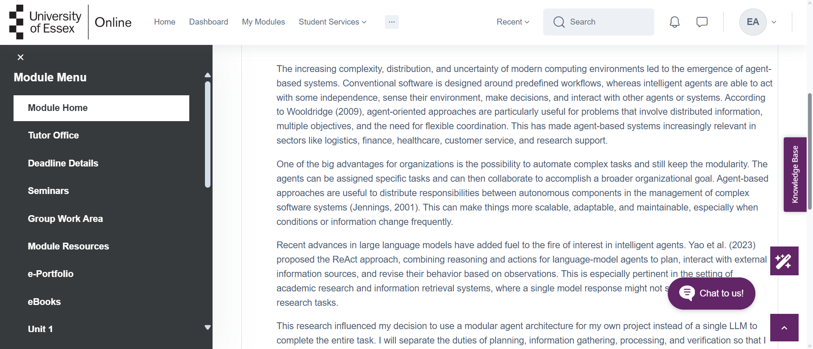

*Figure 1. Initial contribution to the Agent-Based Systems discussion.*


*Figure 2. Evidence of peer engagement.*


*Figure 3. Summary reflection for Units 1–3.*

---

# 2. Teamwork and Individual Contribution

The team project required discussion of architectural decisions, allocation of responsibilities and collaborative development. This experience improved my ability to justify technical choices and respond constructively to feedback.


*Figure 4. Evidence of my contribution to team planning and project coordination.*


*Figure 5. Evidence of team feedback and collaborative decision-making.*

---

# 3. Hybrid Agent Architectures

ScholarPlan was implemented as a modular multi-agent system consisting of a Planner, Retriever, Processor, Critic and Archivist coordinated through a shared SQLite blackboard.

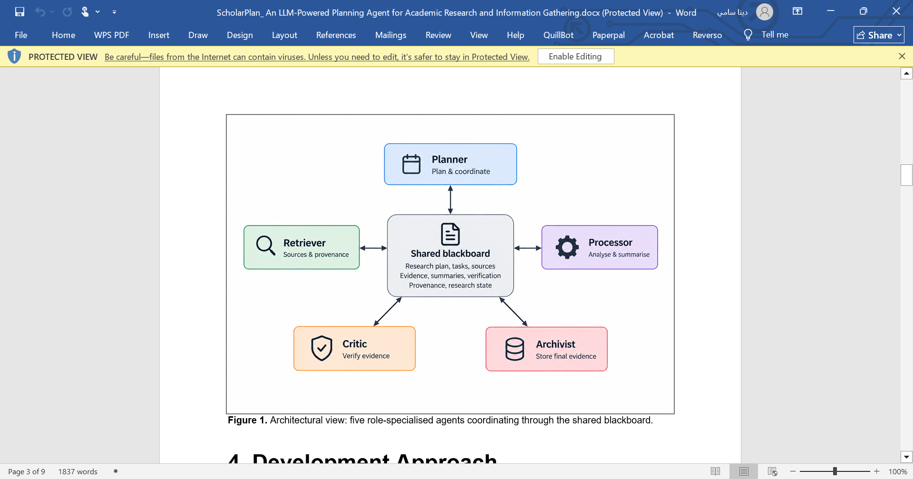

*Figure 6. ScholarPlan modular multi-agent architecture.*

---

# 4. Agent Communication – KQML and KIF

The module introduced agent communication languages such as KQML and their differences from direct method invocation in Python or Java.

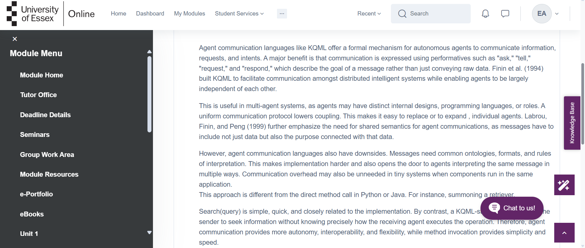

*Figure 7. Discussion comparing KQML and conventional method invocation.*

### Practical KQML/KIF Activity

```text
Alice → Bob

(ask-one
  :sender Alice
  :receiver Bob
  :language KIF
  :ontology warehouse-stock
  :content
    (available-stock television-50-inch ?quantity)
)

Bob → Alice

(tell
  :sender Bob
  :receiver Alice
  :language KIF
  :ontology warehouse-stock
  :content
    (available-stock television-50-inch 24)
)

Alice → Bob

(ask-one
  :sender Alice
  :receiver Bob
  :language KIF
  :ontology warehouse-stock
  :content
    (hdmi-slots television-50-inch ?slots)
)

Bob → Alice

(tell
  :sender Bob
  :receiver Alice
  :language KIF
  :ontology warehouse-stock
  :content
    (hdmi-slots television-50-inch 3)
)
# 5. NLP and Parse Trees

The constituency-based parsing activity developed my understanding of hierarchical language structure and syntactic ambiguity. The sentence *“The man saw the dog with the telescope”* was particularly useful because the phrase *“with the telescope”* can attach either to the verb phrase or the noun phrase, resulting in different interpretations.

This demonstrated that natural-language systems cannot always determine meaning from surface structure alone and may require contextual reasoning to resolve ambiguity.

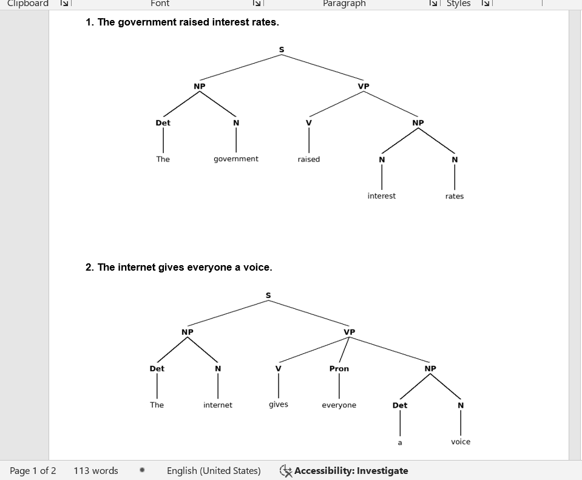

*Figure 8. Constituency-based parse tree activity.*

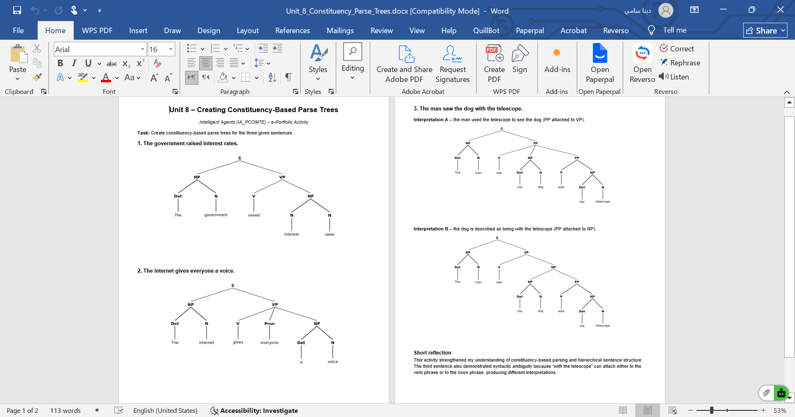

*Figure 9. Alternative parse structures demonstrating syntactic ambiguity.*

---

# 6. Deep Learning and Responsible AI

The later units expanded my focus from technical capability to the wider implications of intelligent technologies. The Deep Learning discussion considered hallucination, bias, privacy and accountability. Ji et al. (2023) identify hallucination as an important challenge in natural-language generation, while Bender et al. (2021) highlight wider concerns relating to bias in large language models.

The Deep Learning in Action activity further demonstrated that high predictive performance does not automatically mean responsible deployment. Intelligent systems also require representative data, transparency, appropriate validation and human oversight.

This affected how I evaluated ScholarPlan because academic-looking LLM output cannot be assumed to be reliable simply because it is fluent.

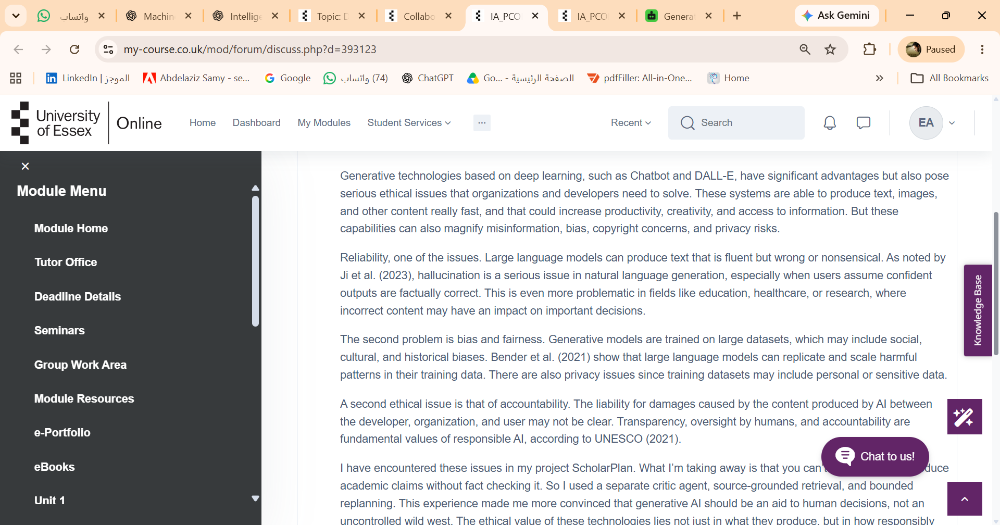

*Figure 10. My discussion of ethical issues associated with generative AI.*

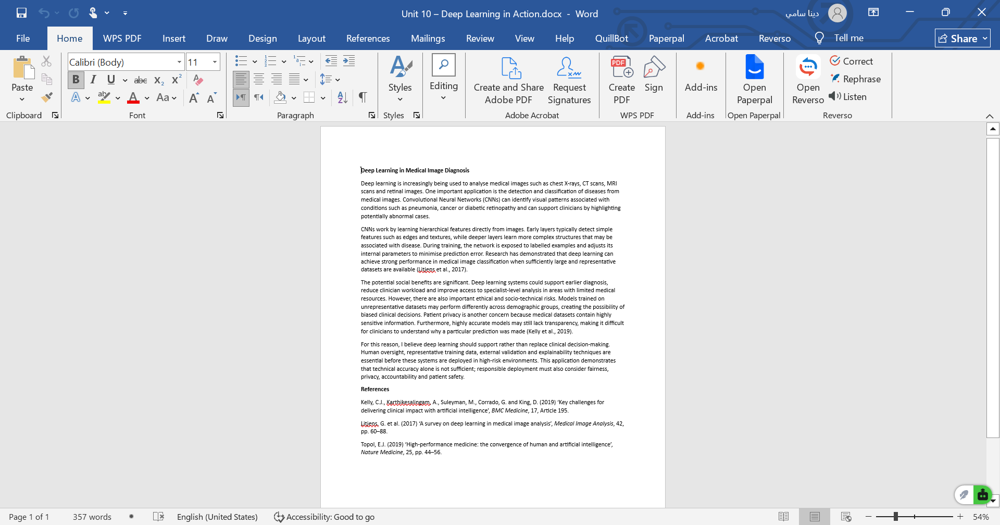

*Figure 11. Deep Learning in Action activity examining technical and socio-ethical implications.*

---

# 7. ScholarPlan – From Design to Implementation

The Week 11 implementation allowed me to critically compare the working system with the earlier design. Core features such as modular agents, the shared blackboard and an independent Critic were retained.

Tutor feedback identified three important areas for improvement: the absence of a static UML Class Diagram, broad evaluation criteria and the need for a clear fallback rule when replanning repeatedly fails.

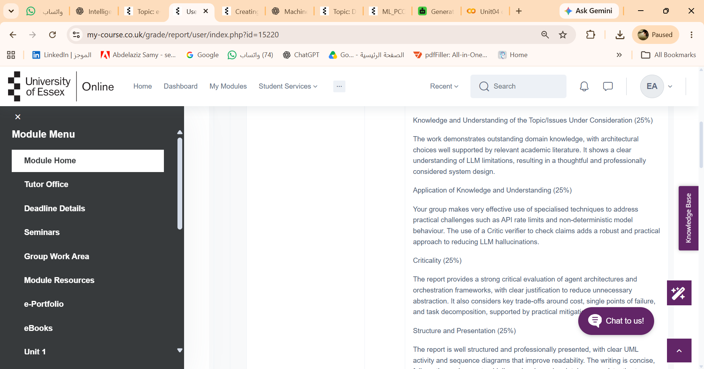

*Figure 12. Tutor feedback that informed the final ScholarPlan implementation.*

I addressed these issues by adding the UML diagram, introducing measurable evaluation targets and limiting replanning to three attempts before a task is marked `unresolvable`.

The implementation also changed technically. Azure was considered during the design phase, but the final working demonstration used **Qwen2.5-3B-Instruct through LM Studio**. Live scholarly retrieval used **OpenAlex, Crossref and arXiv**.

Testing revealed problems that had not been obvious during design, including malformed structured responses and unreliable model outputs. JSON repair and source-grounded fallback behaviour were therefore added. A relevance gate was also implemented so that evidence-supported but off-topic claims did not automatically enter the final report.

The completed live run processed three tasks, retrieved 15 records and produced 12 evidence-verified claims. The automated test suite reported **7/7 passing tests**, including the three-attempt replanning rule.

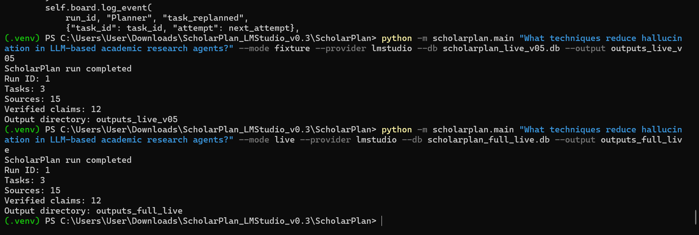

*Figure 13. Successful ScholarPlan live execution showing 3 tasks, 15 retrieved records and 12 verified claims.*

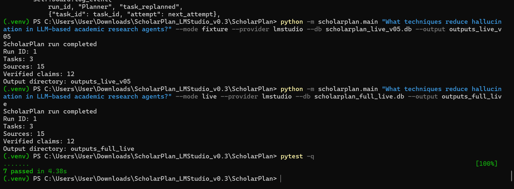

*Figure 14. Automated testing showing that all seven ScholarPlan tests passed successfully.*

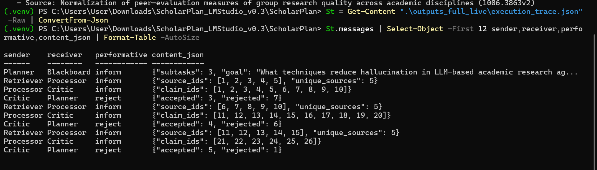

*Figure 15. ScholarPlan execution trace showing auditable communication between the Planner, Retriever, Processor and Critic.*

---

# 8. Reflective Case Studies

## 8.1 AI Safety Constraints

### WHAT

ScholarPlan could repeatedly replan when a subtask failed to generate acceptable evidence. I introduced a limit of three attempts before the task became `unresolvable`.

### SO WHAT

This demonstrated that autonomy requires explicit safety boundaries. An unrestricted loop could waste resources and create unpredictable behaviour.

### NOW WHAT

In future projects, I would define retry limits, escalation mechanisms and human intervention points from the beginning rather than adding them after implementation.

---

## 8.2 Explainable Decisions

### WHAT

ScholarPlan records messages, retrieved evidence and Critic decisions in the SQLite blackboard and execution trace.

### SO WHAT

This allows me to identify why claims were accepted, rejected or replanned. I learned that explainability can involve making an agent's decision process observable rather than attempting only to explain the neural model itself.

### NOW WHAT

Future versions would include clearer rejection reasons, evidence links and confidence indicators for users.

---

## 8.3 Responsible Deployment

### WHAT

Live LLM output could be malformed, unsupported or insufficiently relevant to the original question.

### SO WHAT

I learned that successful text generation is not equivalent to reliable deployment. Verification, relevance assessment and failure handling are essential when outputs may influence academic research.

### NOW WHAT

I would strengthen semantic retrieval, evaluate the system on larger labelled datasets and introduce human review for high-risk outputs.

---

# 9. Final Reflection

This reflection follows the **WHAT, SO WHAT and NOW WHAT** framework of Rolfe, Freshwater and Jasper (2001).

## WHAT

At the beginning of the Intelligent Agents module, I understood agents mainly as autonomous software components capable of performing tasks on behalf of users. The early discussions introduced autonomy, coordination and different agent architectures, while later activities addressed KQML, NLP, deep learning and responsible AI. ScholarPlan brought these areas together in one practical implementation.

My final system included a Planner, Retriever, Processor, Critic and Archivist coordinated through a persistent SQLite blackboard. This was different from my earlier assumption that an intelligent research agent could largely be created by connecting an LLM to external information sources.

The implementation stage was more difficult than the design stage. Azure had originally been considered, but I eventually used Qwen2.5-3B-Instruct through LM Studio. After connecting the model, I encountered malformed JSON, incomplete planning outputs and candidate claims that had to be rejected. These problems required JSON repair, fallback behaviour, bounded replanning and a relevance gate.

## SO WHAT

These failures became some of my most important learning experiences. Initially, repeated integration problems were frustrating because an individual component could appear to work correctly but fail once it interacted with retrieval, processing and verification. I sometimes focused too quickly on changing the prompt rather than first identifying the exact source of the problem.

Gradually, I adopted a more systematic debugging process. I separated the workflow into planning, retrieval, processing, verification and publication, and examined each stage individually. This reduced uncertainty and made failures easier to isolate. The experience taught me that developing intelligent systems requires planning for failure, not only demonstrating successful outputs.

The tutor feedback on the earlier design became particularly useful at this stage. For example, the design requirement to “support replanning” was too broad to evaluate objectively. Implementing a maximum of three attempts transformed it into measurable and testable behaviour.

My understanding of communication also changed. The KQML activities showed that agent messages can express both content and intention. ScholarPlan did not implement the entire KQML specification, but the use of `request`, `inform`, `confirm` and `reject` made interactions easier to inspect. Persisting them in the blackboard created an audit trail and showed me that explainability can be achieved partly through system architecture.

The deep-learning discussions also changed the way I evaluate model quality. Earlier, I might have considered a fluent response evidence that an LLM was functioning effectively. I now recognise that fluent language can hide unsupported claims. Hallucination, bias, relevance and accountability therefore need to be considered alongside technical performance.

Teamwork also influenced my learning. Discussing architectural choices required me to explain and justify assumptions, while peer discussions exposed me to alternative approaches. This taught me to regard feedback as part of development rather than simply as evaluation after the work was completed.

## NOW WHAT

If I developed ScholarPlan again, I would change the sequence of development. I would define measurable evaluation criteria first, develop deterministic tests earlier and specify structured-output schemas before integrating the LLM. I would also design failure states, retry limits and escalation mechanisms from the beginning.

The relevance component could also be strengthened. The current implementation uses a transparent lexical baseline, while future development could use Sentence-BERT embeddings for semantic similarity (Reimers and Gurevych, 2019). I would evaluate this using a larger labelled dataset rather than relying mainly on demonstration queries.

For applications with greater consequences, I would introduce explicit human approval points and clearer uncertainty reporting. The most significant lesson I take from the module is that an intelligent system should not be judged only by how capable the underlying model appears. It should also be evaluated according to how its decisions are verified, explained, bounded, tested and monitored.

---

# 10. Professional Skills Matrix and PDP

| Skill | Current Evidence | Next Action |
|---|---|---|
| Critical Thinking | Critic and relevance evaluation | Use larger evaluation sets |
| IT & Digital | Python, SQLite, LM Studio and GitHub | Develop CI/CD skills |
| Problem Solving | JSON repair and fallback logic | Test failure cases earlier |
| Teamwork | Team design and peer discussions | Maintain structured meeting notes |
| Ethical Awareness | Safety, XAI and deployment case studies | Define human-oversight criteria |

My Personal Development Plan focuses on stronger evaluation, automated testing, structured collaboration and responsible deployment of intelligent agents.

---

# References

Bender, E.M., Gebru, T., McMillan-Major, A. and Shmitchell, S. (2021) ‘On the dangers of stochastic parrots: Can language models be too big?’, *Proceedings of the 2021 ACM Conference on Fairness, Accountability, and Transparency*, pp. 610–623.

Finin, T., Fritzson, R., McKay, D. and McEntire, R. (1994) ‘KQML as an agent communication language’, *Proceedings of the Third International Conference on Information and Knowledge Management*, pp. 456–463.

Ji, Z. et al. (2023) ‘Survey of hallucination in natural language generation’, *ACM Computing Surveys*, 55(12), Article 248.

Labrou, Y., Finin, T. and Peng, Y. (1999) ‘Agent communication languages: The current landscape’, *IEEE Intelligent Systems and Their Applications*, 14(2), pp. 45–52.

Parasuraman, R., Sheridan, T.B. and Wickens, C.D. (2000) ‘A model for types and levels of human interaction with automation’, *IEEE Transactions on Systems, Man, and Cybernetics – Part A: Systems and Humans*, 30(3), pp. 286–297.

Reimers, N. and Gurevych, I. (2019) ‘Sentence-BERT: Sentence embeddings using Siamese BERT-networks’, *Proceedings of EMNLP-IJCNLP 2019*, pp. 3982–3992.

Rolfe, G., Freshwater, D. and Jasper, M. (2001) *Critical Reflection in Nursing and the Helping Professions: A User’s Guide*. Basingstoke: Palgrave Macmillan.

Wooldridge, M. (2009) *An Introduction to MultiAgent Systems*. 2nd edn. Chichester: Wiley.
